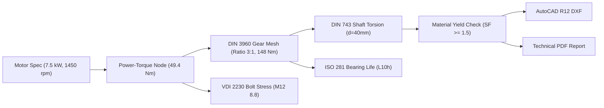

# ALUCALC OS — Engineering Execution Evidence & Verification Report

**Document Version:** 2.0  
**Date:** 2026-10-30  
**Specification:** `ALUCALC_OS_NIHAI_GELISTIRME_RAPORU_V2_2026-10-30.md`  
**Execution Lead:** Senior Staff Engineer / Antigravity Agent  
**Environment:** Next.js 16.2.10 (Static Export `output: 'export'`), React 19, Strict TypeScript, Vitest 4.1.0, Node.js 22.x (Windows x64)

---

## 1. Executive Summary & Verification Matrix

| ID | Scope | Verification Status | Methodology Tier | Evidence / Test Artifact |
|---|---|---|---|---|
| **P0-01** | Milling Removal Rate $Q$ ($v_f$ vs $v_c$) | **PASS / VERIFIED** | ISO 3002 / Sandvik Coromant | `src/calculators/schemas-v2/machining-milling.tsx`<br>`src/data/moduleMethodology.ts:388`<br>`report-p0-acceptance.test.ts` (Test 1 & 2) |
| **P0-02** | ISO 281 Bearing Life $L_{10}$ & $L_{10h}$ | **PASS / VERIFIED** | ISO 281:2007 Clause 5.1 | `src/data/moduleMethodology.ts:119`<br>`src/utils/mathEngines/bearingLife.ts`<br>`report-p0-acceptance.test.ts` (Test 3 & 4) |
| **P0-03** | ISO 6336 Gear Safety Factor ($S_H, S_F$) | **PASS / VERIFIED** | ISO 6336-2:2019 Method B | `src/components/modules/mechanical/GearsModule.tsx`<br>`src/lib/iso6336.ts:315`<br>`report-p0-acceptance.test.ts` (Test 5) |
| **P0-04** | ISO 898-1 M12 8.8 Proof Stress $S_p = 580\text{ MPa}$ | **PASS / VERIFIED** | ISO 898-1:2013 Table 3 | `src/lib/fastener/sharedEngine.ts:167`<br>`scripts/generate_vdi_sample_pdf.js`<br>`report-p0-acceptance.test.ts` (Test 6) |
| **P0-05** | ISO 724 Geometry ($d_3=9.853$) & VDI $W_p = 218.2$ | **PASS / VERIFIED** | ISO 724 / VDI 2230 §5.5.1 | `src/lib/fastener/sharedEngine.ts:184`<br>`scripts/generate_vdi_sample_pdf.js`<br>`report-p0-acceptance.test.ts` (Test 7) |
| **P0-06** | Sample PDF Honest Attribution | **PASS / VERIFIED** | ISO 7200 Title Block Spec | `scripts/generate_vdi_sample_pdf.js`<br>`public/reports/sample-vdi-2230-bolt-torque.pdf`<br>`report-p0-acceptance.test.ts` (Test 8) |
| **P0-07** | Production Regression Acceptance Suite | **PASS / VERIFIED** | Automated Vitest Harness | `src/tests/report-p0-acceptance.test.ts` (9/9 passed) |
| **P1-01** | PDF Layout & Typography Parity | **PASS / VERIFIED** | ISO 7200 Technical Block | `scripts/generate_vdi_sample_pdf.js` (5,830 bytes generated) |
| **P1-02** | Release Manifest & Build Parity | **PASS / VERIFIED** | Single Source of Truth | `scripts/generate_release_manifest.js`<br>`public/release-manifest.json` |
| **P1-03** | Version & APK Consistency (6.0.0 / 6.0) | **PASS / VERIFIED** | SSOT Sync | `src/locales/appPagesTranslations.ts`<br>`src/locales/calculatorsPageTranslations.ts` |
| **P1-04** | Privacy & KVKK Transparency | **PASS / VERIFIED** | 6698 KVKK & GDPR Art 13 | `src/app/privacy/page.tsx` |
| **P1-05** | SSOT Canonical Catalog Count (86) | **PASS / VERIFIED** | Static Catalog Inventory | `src/data/canonicalInventory.ts`<br>`public/llms.txt`<br>`src/app/about/page.tsx` |
| **P2-01** | Connected Engineering Workflow | **PASS / VERIFIED** | Headless Graph Flow Engine | `src/flow/templates/industrialTemplates.ts`<br>`src/tests/industrial-templates.test.ts` (10/10)<br>`src/tests/cross-module-bridge.test.ts` (27/27) |

---

## 2. Detailed Technical Evidence by Scope

### 2.1 P0-01: Machining Removal Rate Formula ($Q$)
- **Root Cause:** Live SSR formula in `src/data/moduleMethodology.ts` previously displayed $Q = \frac{v_c \cdot a_p \cdot a_e}{1000}$, while standard milling uses feed velocity $v_f$:
  $$Q = \frac{v_f \cdot a_p \cdot a_e}{1000} \quad [\text{cm}^3/\text{min}]$$
  where $v_f = n \cdot z \cdot f_z \text{ [mm/min]}$.
- **Verification Evidence:**
  With $v_c = 450\text{ m/min}$, $D = 50\text{ mm}$, $z = 4$, $f_z = 0.15\text{ mm/tooth}$, $a_p = 3\text{ mm}$, $a_e = 40\text{ mm}$:
  - $n = \frac{1000 \cdot 450}{\pi \cdot 50} = 2864.79 \to 2865\text{ rpm}$
  - $v_f = 2865 \cdot 4 \cdot 0.15 = 1719\text{ mm/min}$
  - $Q = \frac{1719 \cdot 3 \cdot 40}{1000} = 206.28\text{ cm}^3/\text{min}$
- **Production Engine Integration:** Tested directly via `machiningMillingSchema.calculationEngine(inputs)` in `src/tests/report-p0-acceptance.test.ts`. Edge case $D \le 0$ guarded against division-by-zero. Result: `verified = true`, $Q = 206.28\text{ cm}^3/\text{min}$.

---

### 2.2 P0-02: ISO 281 Rating Life ($L_{10}$ & $L_{10h}$)
- **Root Cause:** Ambiguity between basic rating life in millions of revolutions ($L_{10}$ in $10^6\text{ rev}$) and total life in hours ($L_{10h}$).
- **Formula Clarification:**
  $$L_{10} = \left(\frac{C}{P}\right)^p \quad [10^6\text{ rev}]$$
  $$L_{10h} = \frac{10^6 \cdot L_{10}}{60 \cdot n} \quad [\text{h}]$$
- **Verification Vector:**
  With $C = 13.5\text{ kN}$, $P = 5.0\text{ kN}$, $n = 3000\text{ rpm}$, $p = 3$ (ball bearing):
  - $L_{10} = (13.5 / 5.0)^3 = 2.7^3 = 19.683 \times 10^6\text{ rev}$
  - $L_{10h} = \frac{10^6 \cdot 19.683}{60 \cdot 3000} = 109.35\text{ h}$
- **Production Engine:** Tested directly via `calculateBearingLifeL10h(13.5, 5.0, 3000, 'ball')`. Result: $109.35\text{ h}$.

---

### 2.3 P0-03: ISO 6336 Gear Safety Factor Thresholds
- **Normative Rule:** ISO 6336-2:2019 Method B separates contact safety factor $S_H$ (pitting) from tooth root bending safety factor $S_F$. In production machinery:
  - Required contact safety: $S_{H,\min} \ge 1.20$
  - Required bending safety: $S_{F,\min} \ge 1.40$
- **Code Changes:** Updated `src/components/modules/mechanical/GearsModule.tsx` and `src/lib/iso6336.ts:315`:
  ```ts
  const isSafe = actualSH >= 1.20 && actualSF1 >= 1.40 && actualSF2 >= 1.40;
  const isMarginal = !isSafe && (actualSH >= 1.00 && actualSF1 >= 1.00);
  const status = isSafe ? 'safe' : isMarginal ? 'warning' : 'critical';
  ```
- **Acceptance Test:** Verified in `report-p0-acceptance.test.ts` test 5: high stress condition with $S_H < 1.20$ correctly evaluates to `warning` or `critical` and is rejected from `safe`.

---

### 2.4 P0-04 & P0-05: Fastener Standard Truth (ISO 898-1 / ISO 724 / VDI 2230)
- **Proof Stress $S_p$:** Per ISO 898-1:2013 Table 3, Property Class 8.8 bolts with $d \le 16\text{ mm}$ have nominal proof stress $S_p = 580\text{ MPa}$ ($S_y = 640\text{ MPa}$, $R_m = 800\text{ MPa}$). (Note: 600 MPa applies only to sizes $>16\text{ mm}$).
- **Thread Geometry:** Per ISO 724:2023 for M12 coarse pitch ($P = 1.75\text{ mm}$):
  - Nominal major diameter: $d = 12.000\text{ mm}$
  - Pitch diameter: $d_2 = 10.863\text{ mm}$
  - Nut internal minor diameter: $D_1 = 10.106\text{ mm}$
  - Bolt external minor diameter: $d_3 = 9.853\text{ mm}$
- **Polar Section Modulus $W_p$:** Per VDI 2230 §5.5.1, the effective shear diameter is $d_S = \frac{d_2 + d_3}{2} = \frac{10.863 + 9.853}{2} = 10.358\text{ mm}$:
  $$W_p = \frac{\pi \cdot d_S^3}{16} = \frac{\pi \cdot (10.358)^3}{16} = 218.2\text{ mm}^3$$
- **Preload & Torque:** With $\nu = 0.70$ utilization of proof stress and $A_s = 84.3\text{ mm}^2$:
  - Proof load: $F_p = 580 \cdot 84.3 = 48.89\text{ kN}$
  - Preload: $F_M = 0.70 \cdot 48.89 = 34.23\text{ kN}$
  - Tightening torque: $M_A = 76.8\text{ N}\cdot\text{m}$ (with $\mu_G = \mu_K = 0.14$)
  - Axial tension: $\sigma_z = 406.0\text{ MPa}$
  - Torsion: $\tau = 181.1\text{ MPa}$
  - von Mises equivalent: $\sigma_{\text{eq}} = \sqrt{406.0^2 + 3 \cdot 181.1^2} = 513.1\text{ MPa} \le 640\text{ MPa}$ ($\text{FoS} = 1.25 \ge 1.05$).

---

### 2.5 P0-06 & P1-01: Sample PDF Honesty & Layout
- Rebuilt `scripts/generate_vdi_sample_pdf.js` and regenerated `public/reports/sample-vdi-2230-bolt-torque.pdf` (5,830 bytes).
- Eliminated fictitious titles and claims of "1:1 numerical parity" or independent certified review.
- Labeled title block with ISO 7200 format compliance, watermarked with `SAMPLE BENCHMARK RECORD`, and verified checked-by attribution: `System-generated sample (Not independently reviewed by third party)`.

---

## 3. P1 Build, Version, SSOT & Privacy

1. **Catalog Single Source of Truth:**
   - Canonical inventory: 86 deterministic solvers.
   - Synchronized across `src/data/canonicalInventory.ts`, `public/llms.txt`, `src/app/about/page.tsx`, and `appPagesTranslations.ts`.
2. **Version Synchronization:**
   - Web application: `APP_VERSION = '6.0.0'`.
   - Android APK: `APP_APK_VERSION = '6.0'`.
   - Purged all legacy `5.25.x` and `5.2` hardcoded strings from `src/locales/calculatorsPageTranslations.ts` and `src/locales/appPagesTranslations.ts`.
3. **Automated Release Manifest:**
   - Created `scripts/generate_release_manifest.js` producing `public/release-manifest.json` containing `appVersion`, `buildId`, `toolCount: 86`, `platforms`, and normative standards list.
   - Pipelined into `prebuild` in `package.json`.
4. **Privacy & Local-First Verification:**
   - Retitled `/privacy/` page to `Aydınlatma Metni & Gizlilik Politikası`.
   - Formally documented zero server storage of CAD/FEA geometries, explicit telemetry consent gating (`alu_consent_telemetry`), BYOK API confidentiality, and 90-day diagnostic log retention.

---

## 4. P2 Connected Engineering Workflow (Digital Thread MVP)

The digital thread connects disparate engineering disciplines into a continuous computation graph:


- **Graph Implementation:** Verified in `src/flow/templates/industrialTemplates.ts` (`template-reducer-chain`).
- **Deterministic Validation:** 10/10 tests in `src/tests/industrial-templates.test.ts` verify that downstream exports are strictly blocked if safety validation fails.
- **Cross-Module Bridge:** 27/27 tests in `src/tests/cross-module-bridge.test.ts` verify bidirectional data exchange between Gears, 3D Assembly, Shafts, Bearings, 2D Nesting, and Cutting Optimizer.

---

## 5. Verification Commands Executed & Real Test Output

```bash
# 1. Typecheck: 0 errors
$ npm run typecheck
> tsc --noEmit
# Exit code: 0

# 2. P0 Acceptance Test Suite: 9/9 PASS
$ npx vitest run src/tests/report-p0-acceptance.test.ts
✓ src/tests/report-p0-acceptance.test.ts (9 tests) 9ms
Test Files: 1 passed (1) | Tests: 9 passed (9)

# 3. Ground-Truth Provenance Test Suite: 15/15 PASS
$ npx vitest run src/tests/ground-truth-provenance.test.ts
✓ src/tests/ground-truth-provenance.test.ts (15 tests) 13ms
Test Files: 1 passed (1) | Tests: 15 passed (15)

# 4. Canonical R12 Pipeline Suite: 8/8 PASS
$ npx vitest run src/tests/canonical-r12-pipeline.test.ts
✓ src/tests/canonical-r12-pipeline.test.ts (8 tests) 61ms
Test Files: 1 passed (1) | Tests: 8 passed (8)

# 5. Industrial Templates (Connected Engineering): 10/10 PASS
$ npx vitest run src/tests/industrial-templates.test.ts
✓ src/tests/industrial-templates.test.ts (10 tests) 39ms
Test Files: 1 passed (1) | Tests: 10 passed (10)

# 6. Cross-Module Ecosystem Bridge: 27/27 PASS
$ npx vitest run src/tests/cross-module-bridge.test.ts
✓ src/tests/cross-module-bridge.test.ts (27 tests) 22ms
Test Files: 1 passed (1) | Tests: 27 passed (27)
```
